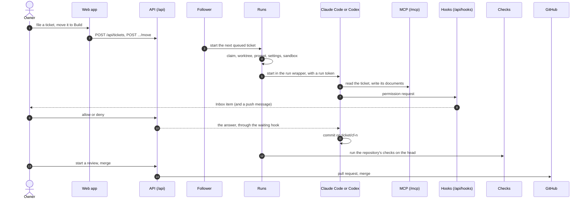

# code-factory

<p align="center"></p>

<p align="center"><strong>From ticket to merged code, with agents.</strong></p>

[](https://github.com/ilovepixelart/code-factory/blob/main/pyproject.toml)
[](https://github.com/ilovepixelart/code-factory/blob/main/LICENSE)
\
[](https://sonarcloud.io/summary/new_code?id=ilovepixelart_code-factory)
[](https://sonarcloud.io/summary/new_code?id=ilovepixelart_code-factory)
\
[](https://sonarcloud.io/summary/new_code?id=ilovepixelart_code-factory)
[](https://sonarcloud.io/summary/new_code?id=ilovepixelart_code-factory)
[](https://sonarcloud.io/summary/new_code?id=ilovepixelart_code-factory)

code-factory is a local, single-owner board that takes software work from a ticket to a merged
GitHub pull request. Claude Code and Codex work in separate Git worktrees and use MCP tools and
hooks to talk to the board. The owner reviews decisions in the browser. The app runs over
PostgreSQL and is built with [FastAPI](https://fastapi.tiangolo.com/),
[FastMCP](https://gofastmcp.com/) and [Vue](https://vuejs.org/). Version 0.1.0 is under development.
See [Current limits](#current-limits).

[Project site](https://ilovepixelart.github.io/code-factory/)

## Table of Contents

- [How It Works](#how-it-works)
- [Principles](#principles)
- [Project Structure](#project-structure)
- [Features](#features)
- [Quick Start](#quick-start)
- [Configuration](#configuration)
- [Tech Stack](#tech-stack)
- [Development](#development)
- [Current limits](#current-limits)
- [Documentation](#documentation)

## How It Works

A ticket moves through the columns Spec, Build, Review and Merged. The owner files it on the board;
an agent claims it, works its column in a worktree of its own and asks the owner through the Inbox
when it needs a decision; checks and a review run judge the branch; the board opens and merges the
pull request.



### Step by step

**1. File and move.** The owner files a ticket on the board (`POST /api/tickets`); it starts in
Spec. A move is refused unless the stage rules allow it: Build needs a branch, Review a commit on
it (`ticket_writes/rules`, `stages`).

**2. Claim and start.** When automatic runs are configured, the follower takes queued work.
The owner can also press Start agent
(`POST /api/tickets/{repository}/{id}/runs`). The team module picks the agent and claims the
ticket. The runs module prepares the worktree, the stage prompt and the selected CLI's launch
settings. The agent reaches the board's HTTP MCP server with a token bound to the run
(`runs/service/launching.py`).

**3. Work.** The agent runs inside the run wrapper, which records its exit code
(`runs/adapters/runner/`). It reads and writes the ticket only through MCP tools
(`tickets/tools`, `talk/tools.py`, `memory/tools.py`); every call passes the access policy and a
limit of 120 calls a minute (`platform/mcp`).

**4. Ask.** A tool the sandbox or the standing rules do not settle becomes a permission request:
the hook waits up to 540 seconds while the request sits in the Inbox, and the owner's Allow or Deny
travels back to the agent (`hooks/routes.py`, `runs/service/permissions.py`). Questions, screens
to approve and failing checks wait in the same Inbox; with a push target set, each new item is
also sent to the owner's phone with a link that answers it (`push`).

**5. Judge and merge.** The checks module runs the repository's checks command on the branch
head and keeps the verdict; a review run judges the change; the delivery module opens the pull
request and merges it (`checks`, `runs`, `delivery`). The ticket moves to Merged.

## Principles

A person's time and attention are what the factory spends most carefully. Writing a change costs
less every month; reading one does not.

- **Ask only what needs a person.** The Inbox gathers the questions, permissions, reviews and
  merges that wait on the owner, each with a recommended answer, and the board says each thing
  once.
- **Plan before building.** A ticket is specified in the Spec column before an agent builds it.
- **Review in proportion to the stakes.** A pull request shows its size and reads as large past
  400 changed lines; a repository may let a small, plain change merge without review
  (`[merge] unreviewed_lines`), never one that touches its config or a sensitive path.
- **Verification belongs to the repository.** Its own checks command judges every branch before
  a merge.
- **Judge outcomes, not output.** Analytics leads with first-pass yield and human intervention,
  then whether shipped work held, and only then with how much shipped.
- **Learn from the runs.** Agents propose memory the owner approves, and scorers ask a repository's
  own questions of its sessions, such as whether a test failed before the code changed.

## Project Structure

```bash
code-factory/
├── src/code_factory/
│   ├── app.py              # Composition root: MODULES, services, the code-factory command
│   ├── platform/           # Shared kernel, imports no module
│   │   ├── config.py       # Settings from CODE_FACTORY_* variables and env files
│   │   ├── keychain.py     # The database password from the keychain when the URL omits it
│   │   ├── db/             # Base, engine, unit of work, migrations, schema check, advisory locks
│   │   ├── web/            # App factory, lifespan, guard, problem+json errors, conditional GETs
│   │   ├── mcp/            # MCP server, token verifier, access policy, rate limit
│   │   ├── background.py   # The lifespan's task group
│   │   └── cli.py          # Root parser; each module adds its commands
│   └── <module>/           # One domain area: module.py, routes.py, tools.py, cli.py,
│                           # service/, adapters, repository, ports, tables, rules, models
├── alembic/                # One migration history for every module
├── web/                    # The Vue app (pnpm); built into platform/web/dist
├── tests/                  # unit/, integration/, e2e/ per module; support/ helpers (docs/testing.md)
├── scripts/gate.sh         # The gate: static checks, then pytest and the web checks side by side
└── docs/                   # See Documentation below
```

Every module, in the order the app builds them, with its commands, background work, tables and
routes, is in [docs/reference/modules.md](docs/reference/modules.md) and, as one tree, in
[docs/reference/feature-map.md](docs/reference/feature-map.md); every table with its columns is in
[docs/reference/database-tables.md](docs/reference/database-tables.md). All three are generated from
the code by `code-factory docs`. Layers and the import contracts that hold them are in
[docs/architecture.md](docs/architecture.md).

## Features

| Area | What it does | Code |
|---|---|---|
| Board | Columns with limits, cards, filters and saved views, bulk changes, archive, a ticket page with documents, links, activity and undo | `board`, `tickets`, `ticket_writes`, `undo` |
| Inbox | Everything that waits on the owner: questions, permission requests, rules to adopt, memory proposals, stopped agents, screens, failing and mergeable pull requests, failing default branches | `inbox` |
| Push and reply links | One message per new Inbox item to ntfy or a webhook; a link answers a request or question without signing in | `push` |
| Agents and runs | Agents and model connections, claims, runs in worktrees, permissions, previews, split runs | `agents`, `team`, `runs` |
| MCP | Tools for tickets, documents, activity, questions, reviews and memory, per caller and stage | `platform/mcp`, `*/tools.py` |
| Hooks | Permission requests, news for a running agent, recall at session start, the rewrite guard | `hooks` |
| Checks, review, delivery | The checks command and its verdicts, review runs and findings, pull requests and merge | `checks`, `stages`, `delivery` |
| Sessions | Captured agent sessions, their timeline, usage and cost | `sessions` |
| Memory | Rules, decisions and lessons agents load, and their proposals | `memory`, `memory_extras` |
| Flow and Factory | What merged, how long it took, whether it held, what it cost per cohort | `metrics`, `factory`, `evals` |
| Screens | Captures of a ui ticket's pages (`code-factory shoot`) for the owner to approve | `screens` |

The page by page rules of the web app are in [docs/ui.md](docs/ui.md).

## Quick Start

### Local mode

Run the app on your machine with your signed-in Claude Code or Codex CLI. PostgreSQL runs
in Docker. Install the [Local mode prerequisites](docs/quickstart.md#local-mode) and run:

```sh
sh scripts/start.sh --local
```

The launcher opens the board signed in. Track a local checkout and
[run your first agent](docs/quickstart.md#run-the-first-agent).

### Server mode

Run the app and PostgreSQL together in Docker. With Docker Compose installed, run from the
source checkout:

```sh
sh scripts/compose.sh
```

The launcher prints a one-time sign-in link. The first run builds the app image. See
[Server mode setup](docs/quickstart.md#server-mode) for persistence and port options.

To explore the populated board without starting agents, use the [demo](docs/quickstart.md#sample-boards).

| What | Where |
|---|---|
| The board | <http://127.0.0.1:4000> |
| Swagger UI | <http://127.0.0.1:4000/api/docs> |
| MCP over HTTP | `http://127.0.0.1:4000/mcp/` with `Authorization: Bearer <token>` |
| MCP over stdio | `uv run code-factory mcp` |

## Configuration

Settings are `CODE_FACTORY_*` variables, read from the process environment and the env files of the
working directory: `.env`, then `.env.<name>` when `CODE_FACTORY_ENV=<name>`, then `.env.local`
(git ignores it; the database URL with its password goes there). The process environment outranks
every file. Every setting with its default is in [.env.example](.env.example); the source is
`src/code_factory/platform/config.py`. A database URL that names a user and no password takes it
from the keychain item `code-factory-postgres`. A tracked repository's own settings live in its
`.code-factory/config.toml`: [docs/reference/config.md](docs/reference/config.md).

| Variable | Default | Meaning |
|---|---|---|
| `CODE_FACTORY_DATABASE_URL` | none, required | `postgresql+asyncpg://` URL of the database |
| `CODE_FACTORY_HOST` | `127.0.0.1` | address the server binds |
| `CODE_FACTORY_PORT` | `4000` | port the server binds; `0` takes a free one and prints it |
| `CODE_FACTORY_LOG_LEVEL` | `INFO` | `DEBUG`, `INFO`, `WARNING`, `ERROR` or `CRITICAL` |
| `CODE_FACTORY_OPEN` | `True` | whether `serve` opens the browser signed in (on a terminal only) |
| `CODE_FACTORY_DB_SCHEMA` | `public` | schema every table lives in (the browser tests give each server its own) |
| `CODE_FACTORY_DB_POOL_SIZE` | `10` | connections kept in the pool |
| `CODE_FACTORY_DB_MAX_OVERFLOW` | `5` | connections allowed beyond the pool |
| `CODE_FACTORY_DB_POOL_TIMEOUT_S` | `10.0` | seconds to wait for a pooled connection |
| `CODE_FACTORY_DB_POOL_RECYCLE_S` | `1800` | seconds after which a connection is replaced |
| `CODE_FACTORY_READY_TIMEOUT_S` | `2.0` | seconds `/api/ready` waits for the database |
| `CODE_FACTORY_SCHEMA_CHECK_TIMEOUT_S` | `5.0` | seconds the startup schema check waits before reporting the database busy |
| `CODE_FACTORY_SHUTDOWN_TIMEOUT_S` | `10` | seconds the server waits for open requests on shutdown |
| `CODE_FACTORY_STATE_DIR` | `~/.local/state/code-factory` | absolute folder for what is not in the database: run logs, the session spool, check logs and caches |
| `CODE_FACTORY_RELEASES_DIR` | `~/.local/share/code-factory/releases` | absolute folder of the unpacked releases a deploy switches between |
| `CODE_FACTORY_RUN_DIR` | `$XDG_RUNTIME_DIR/code-factory` | absolute folder for a served board's sockets and log (`code-factory-<uid>` in the temporary folder, `$TMPDIR`, when `XDG_RUNTIME_DIR` is unset) |
| `CODE_FACTORY_STOP_AT_EOF` | `False` | end the served board when its standard input closes |
| `CODE_FACTORY_BROKER_CALL_TIMEOUT_S` | `15.0` | seconds a key broker call to a provider may take |
| `CODE_FACTORY_BROKER_SWEEP_INTERVAL_S` | `30.0` | seconds between sweeps of the broker's run keys |
| `CODE_FACTORY_BROKER_READ_TIMEOUT_S` | `600.0` | seconds the broker waits for a provider's answer to stream |
| `CODE_FACTORY_BROKER_MAX_BODY_MIB` | `32` | largest request body the broker forwards, in MiB |

## Tech Stack

| Layer | Technology |
|---|---|
| Language | Python 3.14, async throughout |
| HTTP and MCP | FastAPI, FastMCP (streamable HTTP and stdio), uvicorn |
| Data | PostgreSQL 19, SQLAlchemy asyncio with asyncpg, Alembic |
| Web app | Vue 3, Vue Router, Vite, Tailwind CSS, shadcn-vue on Reka UI, TypeScript |
| Tooling | uv, ruff, ty, import-linter, pytest with xdist, vitest, Playwright |

## Development

`sh scripts/gate.sh` is the gate. It runs, in one chain, `uv lock --check`, `uv sync --locked`,
ruff, ty, the import contracts and the commit message check; then pytest with a coverage floor of
90% (5 xdist workers by default, `CODE_FACTORY_TEST_WORKERS` sets fewer) beside the web app's lint,
types, format, unused code and unit tests, and the web build last. A macOS verification run of
roughly 8,200 Python and 1,400 web tests took 5 minutes 35 seconds. The gate reports timings for
database setup, test execution and each web step.

GitHub pull requests also require 90% coverage on changed executable lines, using the Python
and web reports from those same test runs. Each new production file must meet that floor.

```bash
sh scripts/gate.sh
uv run pytest --no-cov -n 4 tests/tickets          # a subset
```

The local gate reuses a successful full run when the input tree and toolchain match. Use
`--force` for a fresh run. `--fast` tests the Python packages touched by the branch and runs the
Vue unit suite for web source changes. Module suites use four pytest workers by default
(`CODE_FACTORY_FAST_TEST_WORKERS` sets the count). Standalone test files run in one process.
The fast gate opens the test database only when it runs Python tests. Shared inputs trigger a full
run. The delta uses the merge base with the default branch. On a checkout without a remote, use
`--base REF` to check commits already made on `main` against an earlier revision.

Added skips, deleted test cases, and a net loss of assertion lines across changed test files
fail the delta check. A drop in one file produces a warning when the total is preserved, as
when tests move between files. Instruction files over 100 lines also produce warnings.
The gate scans for secrets when Gitleaks is installed.
Use `--secrets` to require Gitleaks, `--audit` to audit changed lockfiles, and
`--diff-coverage` to require 90% coverage on changed executable lines. `--semgrep RULES`
runs a local rules file and reports findings as warnings.
`--mutation` samples up to eight boolean or comparison expressions on changed Python lines
after the full gate. It runs the affected package suites in a disposable copy of the committed
candidate. Surviving mutations and inconclusive runs produce warnings.

GitHub's dependency audit checks only the lockfiles changed by a pull request. Pushes to
`main` and manually dispatched runs check all lockfiles.

Checks run on the Factory host or through its configured container engine. Independently deployed
workers polling a Factory server for jobs are outside the supported deployment modes.

The [container runner example](.code-factory/config.container.example.toml) uses a checks container.
Build its image on the Docker runner from the checkout root, and rebuild it when the toolchain
or a lockfile changes:

```sh
docker build -f .code-factory/checks.Dockerfile -t code-factory-checks:local .
```

The image build caches the locked dependencies and registry metadata used by pnpm's offline
supply-chain checks. The runner starts a fresh loopback PostgreSQL database inside each
network-disabled container. Both gates require Gitleaks. A review fix runs affected tests
first. A passing fast check queues the required full check for the candidate. Changes to
shared inputs make the fast gate run the full suite.

Activate the example as `.code-factory/config.toml` once both gates pass on the runner.
Factory's sandbox integration tests need a runner that supports the sandbox's own Linux
user and mount namespaces. The [host runner example](.code-factory/config.example.toml)
shows the commands for a provisioned host runner.

To opt this repository into advisory scans before merge, add either flag or both to
`[checks] command` in `.code-factory/config.toml`. For example, for a provisioned container
runner with Semgrep installed and a checked-in rules file:

```toml
[checks]
container = "code-factory-checks:local"
command = "sh scripts/gate.sh --force --secrets --semgrep .code-factory/semgrep.yml --mutation"
fast = "sh scripts/gate.sh --fast --force --secrets"
main = "sh scripts/gate.sh --force --secrets"
timeout = 1200
```

The standard checks image needs Semgrep added to use this example. Semgrep scans changed files
for up to 60 seconds. The mutation sample runs after the required gate passes, with a
180-second test budget. Allow time for the optional scans in the runner timeout. Findings and
scanner errors appear in the check log as warnings. Required gate failures still block merge.

For a Python check named by a spec, commit the test before Build and verify the expected red state
from an owner-controlled checkout. Repeat `--check` for each named test. The gate checks the sealed
files in the working tree and the Git index. Keep the receipt outside the repository in a location
the Build agent cannot write, and supply it from the trusted runner.

```sh
uv run --no-sync python scripts/gate_spec_lock.py seal /owner/spec-receipt.json \
  --check tests/test_example.py::test_new_behaviour "the new behaviour is required"
sh scripts/gate.sh --spec-lock /owner/spec-receipt.json
```

A trusted runner can also supply all expected failures in a TOML manifest outside the checkout.
Give each case its own entry with the exact expected assertion message.

```toml
[[checks]]
node = "tests/test_example.py::test_new_behaviour"
reason = "the new behaviour is required"
```

```sh
uv run --no-sync python scripts/gate_spec_lock.py seal /owner/spec-receipt.json \
  --manifest /owner/spec-checks.toml
```

For Factory-managed checks, place the receipt at `spec-locks/CF-<n>.json` in the board's state
directory before Build. Keep the agent sandbox enabled to protect that directory. Factory compares
the candidate's locked files with the sealed commit before the checks command and before accepting
a passing verdict for merge. Changes to the locked files block the candidate even if the checks
command passed earlier. Other test runners can supply the same receipt format. The `commit`
field names the sealed Git commit and the `files` object maps repository-relative paths to
their SHA-256 digests.

To have Factory run the expected-failure checks before Build, place a request at
`spec-lock-requests/CF-<n>.json` in the board's state directory. Commit the test files to the
ticket's branch first. Enable the agent sandbox and set a required `[checks] command` so Factory
can enforce the receipt on merge.

```json
{
  "argv": [
    "/owner/bin/verify-spec",
    "--check",
    "tests/test_example.py::test_new_behaviour",
    "the new behaviour is required"
  ]
}
```

Install the verifier and any scripts it runs outside the board state and the tracked repositories.
For pytest, point the installed wrapper at a trusted copy of `gate_spec_lock.py` and use its
`prove` command. The verifier runs against a disposable checkout with network access off, so any
test tooling and dependencies must already be available. It exits zero only when every named test
fails for its expected reason and emits one single-line JSON receipt. Factory validates the
receipt against the checkout and publishes it in `spec-locks` before launching Build. The board
reports the proof as pending while it runs and can launch the ticket on a later pass. Later starts
reuse the receipt while the request and sealed files agree. A changed request requires reviewing
the existing receipt before another Build can start.

To keep acceptance cases private until QA, put them in `qa-holdouts/CF-<n>.md` inside the board's
state directory. Enable the `qa` review role and use the board's normal agent sandbox, which
blocks Build's access to that directory. The QA run can read only its own ticket's cases through
`get_qa_holdout`. Use stable case identifiers so QA can report a failure without posting the
private inputs or steps to the ticket.

`scripts/eval_pipeline.py` compares settings in disposable checkouts of one commit. Define
each named `[[setup]]` and its `[setup.steps]` boolean switches in a TOML manifest. Switches
are `spec-reader`, `plan-critic`, `qa`, `security`, `tests` and `review`. Pass a driver
that starts an isolated board and measures the same cases in every setup. The runner disables
shipping and records the commit, selected switches, driver exit status, and elapsed time.

```sh
uv run --no-sync python scripts/eval_pipeline.py /owner/matrix.toml /owner/result.json /owner/eval-driver
```

Use a [paired fix-round trial](docs/agents.md#fix-round-cap-trial) to compare caps of two
and three on the same cases, with merge outcomes and measured agent and owner costs.

Tests run only against a database whose name ends in `_test`; each xdist worker migrates a schema
of its own. Work is test first, one behaviour at a time; the rules are in [CLAUDE.md](CLAUDE.md),
testing practice in [docs/testing.md](docs/testing.md) and async rules in
[docs/async.md](docs/async.md). Adding a module: [docs/guides/adding-a-module.md](docs/guides/adding-a-module.md).

## Current limits

- The board serves a single owner on loopback in both modes. The documented installation builds
  the app from a source checkout.
- Local mode uses signed-in Claude Code or Codex CLIs. Server mode runs the board and PostgreSQL
  in Docker, with dedicated database, board state and repository volumes.
- Intake supports GitHub, Linear, Jira and Slack. Delivery opens and merges GitHub pull requests.
- The Inbox's sessions and reviews sections have no source.
- Analytics shows run, delivery and scorer data. Benchmark suites and self-improvement pull
  requests do not have live dashboard data.

## Documentation

| Document | What it covers |
|---|---|
| [docs/quickstart.md](docs/quickstart.md) | Setting up PostgreSQL, the keychain and `.env.local`; running, upgrading and backing up |
| [docs/reference/feature-map.md](docs/reference/feature-map.md) | Every module as one tree: commands, MCP tools, background work, tables, routes (generated) |
| [docs/reference/modules.md](docs/reference/modules.md) | Every module with its commands, tables and routes (generated) |
| [docs/reference/database-tables.md](docs/reference/database-tables.md) | Every table with its columns, types, defaults and keys (generated) |
| [docs/reference/commands.md](docs/reference/commands.md) | Every command and its arguments (generated) |
| [docs/reference/config.md](docs/reference/config.md) | A repository's `.code-factory/config.toml` (generated) |
| [docs/architecture.md](docs/architecture.md) | Modules, layers, contracts, the platform |
| [docs/api.md](docs/api.md) | How the app is served, sign-in, the guard, errors, request conventions |
| [docs/diagrams/](docs/diagrams/) | One flow per page: run lifecycle, permission request, ticket stages, push and reply, MCP request, the Inbox |
| [docs/decisions/](docs/decisions/) | Why the design is as it is, one decision per page |
| [docs/guides/](docs/guides/) | Adding a module, writing an MCP tool, [operations](docs/guides/operations.md): the process, probes, logs, files, the broker, troubleshooting |
| [docs/testing.md](docs/testing.md), [docs/async.md](docs/async.md) | Testing practice; async rules |
| [docs/guides/releasing.md](docs/guides/releasing.md) | Platform integration tests, release builds and first-run verification |
| [docs/ui.md](docs/ui.md), [docs/design.md](docs/design.md) | The web app's pages and design system |
| [docs/agents.md](docs/agents.md), [docs/sessions.md](docs/sessions.md), [docs/stages.md](docs/stages.md), [docs/team.md](docs/team.md), [docs/store.md](docs/store.md), [docs/board.md](docs/board.md), [docs/ticket-writes.md](docs/ticket-writes.md), [docs/settings.md](docs/settings.md), [docs/releases.md](docs/releases.md), [docs/factory.md](docs/factory.md) | One module each |

## License

Code Factory is licensed under the [MIT License](LICENSE). See the
[third-party notices](THIRD_PARTY_NOTICES.md) for bundled assets.
