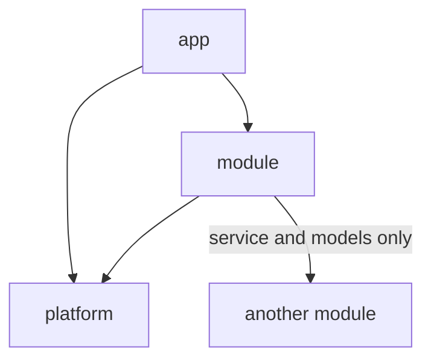
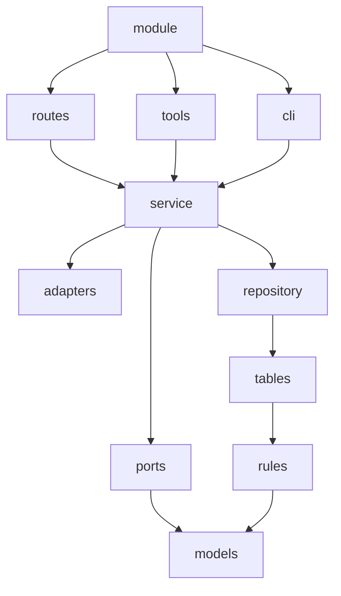

# Architecture

Layout and what goes where are in `CLAUDE.md`. This page holds the rules the code cannot say by
itself: the layering contracts and the migration practice. Each rule names the test that holds it.

## Modules



`app.py` is the one file that knows every module. A module is a package named for a domain area;
each file is one layer, and a layer a module does not need has no file:



`platform` is the kernel every module may import and which imports no module: `config`,
`logging`, `errors`, `background`, `services`, `served`, `runtime`, `commands`, `module`, `cli`, and
the packages `db`, `web` and `mcp`, each the one place its framework lives. Also the helpers that
run outside programs: `process` (a subprocess with a time limit, an output cap and a guaranteed
reaping, `run_logged` for a shell line into a log file), `programs` (a program found only where a
run cannot have replaced it) and `contained` (a command inside srt or as it is).

Every way of running the application enters `platform.runtime.running(resources)`: the HTTP app
(`web/lifespan.py`), the stdio MCP server (FastMCP's `lifespan`, set in `app.create_mcp_server`)
and a CLI command that needs services (`Command.run_async`, run on `app.open_services`). It checks
the schema, accepts background tasks and disposes the engine, so no entry point skips the check.
The MCP server mounted in the HTTP app has no lifespan of its own: the app's starts it.

MCP tool errors: a `CodeFactoryError` reaches the model as its sentence (the same one the HTTP
API answers); any other exception reaches it as FastMCP's masked sentence and is logged with its
traceback (`platform/mcp/errors.py`, `tests/platform/test_mcp_server.py`).

MCP access: every call has an `Actor` (`platform/identity.py`): over HTTP the bearer token verified
by `ActorTokenVerifier` (401 otherwise), over stdio `CODE_FACTORY_MCP_TOKEN` verified again on every
call, in process a fixed actor. `Guard` (`platform/mcp/access.py`) lists only the tools the actor's
role and run stage may call and refuses the rest; the table is `platform/mcp/policy.py`, the matrix
it must equal is written out in `tests/platform/test_mcp_policy.py`. Tokens are issued, verified and
revoked by the `auth` module (`auth_tokens` holds SHA-256 digests only); a tool reads the caller with
`current_actor()` and scopes a ticket with `policy.scope_ticket`. The tool list is pinned by
`tests/golden/mcp/*.json` (names, descriptions, schemas, hints, order; `CODE_FACTORY_BLESS=1` rewrites
them and the diff is read), and `tests/platform/test_mcp_surface.py` holds the rules every tool
follows. A listener may accept only some roles (`Access.roles`): the runner's address takes run
tokens only.

## The registration interface

A module's `module.py` builds one `platform.module.Module`; every field but `name` is optional.

| Field | Meaning |
|---|---|
| `provide(services, resources)` | build the module's service and `services.add(Class, instance)`; `resources` holds the settings, engine and unit of work |
| `router` | a FastAPI `APIRouter`, mounted by `platform.web`; a route reads its service with `Depends(service_of(Class))` |
| `register_tools(mcp, services)` | adds the module's tools to the MCP server; a tool reads its service with `services.get(Class)` |
| `commands` | `Command(name, help, configure, run=...)` or `run_async=...` subcommands of `code-factory`; `run(args)` returns the exit code, `run_async(args, services)` does the same on a started runtime (use it for anything that touches the database); either may raise a `CodeFactoryError`. A `run(args)` command reaches the services with `async with command_services(args)` (`platform/commands.py`; `database=False` for a command that runs before any database exists) and the root parser as `args.root_parser` |
| `background(services, tasks)` | called once when the HTTP app starts, after the schema check: start the module's long-lived work with `tasks.start(name, work)`; not called for the stdio MCP server or a command |
| `serve_command(create_app)` | at most one module: builds the `serve` command in place of the platform's plain one; `create_app(settings, served=...)` takes the `Served` the listener bound |

`Resources.on_stop` is a list a module appends awaitables to in `provide`: they run in order when
the app stops, before the background tasks are cancelled (draining running work), and a failing one
is logged without stopping the rest. `Served` (`platform/served.py`) is registered by
`app.build_services` in every process; `Served.none()` stands for one that serves nothing.

`app.py` holds `MODULES`, builds every `provide` in that order (a module that uses another's service
is listed after it), and passes the list to the platform's factories (`create_web_app`,
`build_mcp`, `cli.main`). Adding a module:

```python
# src/code_factory/app.py
from code_factory.tickets.module import module as tickets  # 1: import

MODULES: tuple[Module, ...] = (about, health, tickets)  # 2: list it
```

plus `code_factory.tickets` in `containers` of the `module-layers` contract in `pyproject.toml`.
`module.py` imports the module's `tables.py`, so importing `app` (which `alembic/env.py` does)
puts every module's tables on `Base.metadata`.

## How a service reaches the database

One way, for HTTP routes, MCP tools, CLI commands and background tasks alike: the service receives
the platform's `UnitOfWork` in its constructor and opens it once per use case. The block commits
when it ends normally and rolls back when it raises, inside the call, so a failed commit is an
exception the caller answers (HTTP 500 `{"error": ...}`), never a response already sent. Routes and
tools hold no session: they call a service and nothing else. A service passes the session to its
repository and never annotates it (`sqlalchemy` stays in `repository`, `tables` and `platform/db`).

```python
class TicketService:
    def __init__(self, uow: UnitOfWork) -> None:  # provide(): TicketService(resources.uow)
        self._uow = uow

    async def rename(self, ticket_id: int, title: str) -> Ticket:
        async with self._uow() as session:  # commit at the end of the block
            return await TicketRepository(session).rename(ticket_id, title)
```

Never hold the block open across a subprocess or an HTTP call (docs/async.md rule 20): read, leave
the block, do the slow work, open a second block to write the result.

## Import contracts

Declared under `[tool.importlinter]` in `pyproject.toml`: direct imports, type-only imports
excluded, each named for its rule. `tests/test_architecture.py` runs them (`use_cases.lint_imports`,
60 s timeout), so `pytest` alone fails on a violation; `uv run lint-imports` prints the detail. A
new violation is fixed, never baselined. Wildcard contracts match every `code_factory.<name>`
package, so a new module joins them without an edit; only `module-layers` lists modules.

| Contract | Rule |
|---|---|
| `module-layers` | inside each module, `module` > `routes \| tools \| cli` > `service` > `adapters \| repository \| ports` > `tables` > `rules` > `models`, each importing only below it |
| `platform-layers` | `cli` > `web` > `mcp` > `runtime \| commands` > `module` > `services \| background` > `db` > `config` > `contained` > `process \| programs` > `text \| network` > `logging \| errors \| identity \| served` |
| `modules-meet-only-through-service-and-models` | a module imports another only through its `service` and `models`; `app` imports each `module.py` |
| `no-cycles-between-modules` | no import cycle between the packages under `code_factory` |
| `platform-imports-no-module` | `platform` imports nothing outside itself |
| `platform-text-is-pure` | no framework, driver, network, process or event loop in `platform.text` and `platform.network` |
| `models-and-rules-are-pure` | no framework, driver, network, process or event loop in `*.models`, `*.rules` and `*.ports` |
| `fastapi-only-at-the-web-edge` | fastapi and starlette only in `*.routes` and `platform.web` |
| `fastmcp-only-at-the-mcp-edge` | fastmcp only in `*.tools` and `platform.mcp` |
| `sqlalchemy-only-at-the-db-edge` | sqlalchemy and asyncpg only in `*.tables`, `*.repository`, `platform.db` and `platform.config` (URL parsing) |
| `edges-never-touch-the-database` | `*.routes` and `*.tools` never import `platform.db`; a service holds the unit of work |

Import-linter checks only what a contract names, so `tests/test_architecture.py` also fails for a
package under `code_factory` missing from `module-layers`, a file in a module that has no layer
name, and a module whose tables `app` does not import. `Module` names the framework types under
`TYPE_CHECKING` only, which the contracts exclude. Each contract was proven by adding one
violating import, seeing the test fail with that contract named, and removing it.

## Shared text helpers

`platform/text/` holds the pure helpers every module shares (moments, words, JSON layout, markdown,
secret masking, the outbound screen, paging, name patterns); its public names are `__all__` of
`platform/text/__init__.py`, pinned by `tests/platform/text/test_exports.py`. Callers import from
`code_factory.platform.text`, never from its files. Gotchas the code cannot say:

- `render_markdown`, `masked` and `screen_words` on text longer than `INLINE_LIMIT` characters run
  in a worker thread (`anyio.to_thread.run_sync` with a limiter): the package itself never imports
  `anyio`, and the regular expressions backtrack on hostile input.
- The screen resolves link destinations with the WHATWG rules (`ada-url`), as a browser does;
  `urllib.parse` keeps the host `github.com` for `\\evil.example\x`.
- Routes using `Paging.from_query` declare `page` and `size` as `str | None`: an `int` annotation
  answers 422 instead of the 400 sentences.

## Request path

Pure ASGI layers, outermost first (`platform/web/middleware.py`): `RequestId` (context variable, response
header, access record), `SecurityHeaders` (strict Content-Security-Policy: scripts same-origin only, styles may be inline for the chart),
`HostGuard` (400 unless `Host` is `localhost`, `127.0.0.1` or `[::1]` on the configured port: DNS
rebinding; a page asked on `localhost` or `[::1]` moves to `127.0.0.1` with a 308, where the session
cookie lives; the mounted MCP server also validates `Origin`, `tests/platform/test_host_guard.py`),
`ErrorBoundary` (the catch-all: logs the exception with the request id, answers a 500 problem
whose detail is `internal error`). The catch-all is a layer, not an `Exception` handler, because
Starlette runs that handler outside every user layer and its answer would lack the request id and
the security headers. Error classes in `platform/errors.py` map to statuses in `platform/web/errors.py`; every
error answer is RFC 9457 problem+json with the sentence as `detail` (see `docs/api.md`).

Swagger UI is a static page plus same-origin files (`platform/web/static`, `platform/web/docs.py`), because
FastAPI's default page loads from a CDN and starts with an inline script. The files are the
`swagger-ui-dist` release pinned in `tests/platform/test_docs.py`, copied verbatim with their licence. No
maintained PyPI package ships them (`swagger-ui-bundle`'s last release is from 2023).

## Migrations

Alembic is the framework (SQLAlchemy's own, async capable). `alembic/env.py` (one history for every module) follows the async
recipe in the Alembic cookbook, "Using asyncio with Alembic"
(https://alembic.sqlalchemy.org/en/latest/cookbook.html#using-asyncio-with-alembic), the same as
`alembic init -t async` in the installed 1.20: an async connection and `run_sync` into
`context.run_migrations()`. The URL comes from the settings, never from `alembic.ini`.

| # | Practice | Held by |
|---|---|---|
| 1 | Constraint naming convention on the metadata (`pk`, `fk`, `uq`, `ix`, `ck`); a check constraint is always given an explicit name | `test_the_naming_convention_derives_a_deterministic_name_for_every_constraint_kind`, `test_constraints_have_the_names_the_convention_derives` |
| 2 | Migrations are the only source of the schema: the test database is built by `alembic upgrade head`, never `create_all`; models and migrations are compared with Alembic's `compare_metadata`, so a model change without a migration fails | `tests/conftest.py` (`migrated`), `test_the_models_and_the_migrations_agree` |
| 3 | One linear history; every revision has a downgrade; upgrade, downgrade to base, upgrade again works | `test_history_is_one_line_...`, `test_every_revision_has_a_downgrade_...`, `test_upgrade_downgrade_upgrade_...`, `test_downgrading_the_data_revision_...` |
| 4 | One transaction per migration (`transaction_per_migration=True`, Postgres DDL is transactional); the migration session sets `lock_timeout` 5 s (fail fast instead of queueing behind a long query, which also blocks everything queued after it) and `statement_timeout` 5 min; an operation that cannot run in a transaction gets its own revision using `op.get_context().autocommit_block()` | `test_each_migration_is_its_own_transaction`, `test_migration_sessions_fail_fast_...`, `test_a_concurrent_index_build_runs_in_an_autocommit_block` |
| 5 | Autogenerate is a draft: every generated file is read and edited by hand (the template says so); server defaults, enum changes, renames and backfills are written explicitly; schema and data migrations are separate revisions (`create schema_info`, then `seed schema_info`) | review; `test_downgrading_the_data_revision_...` covers the data revision on its own |
| 6 | Revision files are `YYYYMMDD_HHMM_<rev>_<slug>.py` (`file_template` in `alembic.ini`) with a descriptive message | `test_every_revision_has_a_downgrade_and_a_readable_sortable_file_name` |
| 7 | Postgres types: `timestamptz` for every time, `text` not `varchar(n)` without a real limit, `jsonb` for document-shaped data (with a comment saying why it is not columns), `NOT NULL` by default, explicit `ON DELETE` on every foreign key, an index on every foreign key column; keys: `bigint` identity for tables of many rows, a constant for the single-row `schema_info` (`platform/db/tables.py`) | `test_columns_use_the_postgres_types_the_rules_ask_for`, `test_every_foreign_key_column_is_indexed` |
| 8 | The app never migrates at startup: it reads the revision and the data format version and refuses to start with the repair sentence; `code-factory db upgrade` is the one way, `db check` reports; the read is bounded by `CODE_FACTORY_SCHEMA_CHECK_TIMEOUT_S` (5 s) and says the database is busy when a migration holds the lock | `tests/platform/test_schema_check.py`, `tests/platform/test_cli.py` |
| 9 | Async engine through the documented recipe | `alembic/env.py`; every test that migrates |

`EXPECTED_REVISION` in `platform/db/schema.py` is the head the app expects; `test_history_is_one_line_...`
fails when it drifts from the script directory. A migration that changes a persisted format
raises `DATA_FORMAT_VERSION` and updates `schema_info` in the same revision.

`code-factory db` loads `alembic.ini` and the revisions from `src/code_factory/platform/db/` in
a source checkout, or from the installed package. The root `alembic.ini` and `alembic/` links
preserve the standard `alembic` commands for contributors working in a checkout.

## Tests

`tests/conftest.py` explains the isolation: each test runs in one outer transaction on one
connection and the app's sessions are bound to it with `join_transaction_mode="create_savepoint"`,
so the real unit of work commits and rolls back for real and nothing persists. Tables are
not truncated because the migration seeds `schema_info`. Under pytest-xdist each worker migrates
a schema of its own inside the test database and drops it at the end, so a test may migrate down
and up; a real `serve` gets a schema of its own as well.
