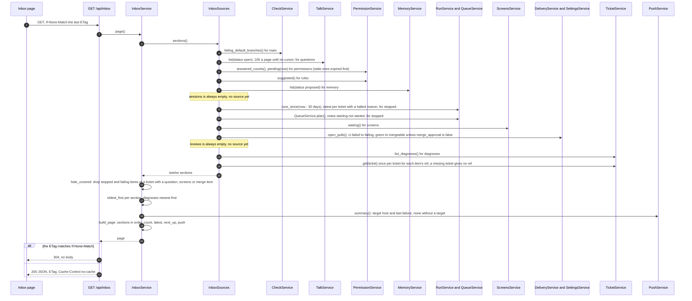

# Inbox

How `GET /api/inbox` is assembled from the module that owns each section, and what the badge counts.

Source: `src/code_factory/inbox/routes.py`, `src/code_factory/inbox/service/__init__.py`, `src/code_factory/inbox/service/neighbours.py`, `src/code_factory/inbox/rules.py`, `src/code_factory/inbox/models.py`, `src/code_factory/platform/web/conditional.py`, `src/code_factory/push/module.py`, `src/code_factory/push/service.py`

## Notes

- Sections, in page order: `main`, `questions`, `permissions`, `rules`, `memory`, `sessions`, `stopped`, `screens`, `mergeable`, `failing`, `reviews`, `diagnoses` (`SECTIONS` in `inbox/models.py`).
- Counted: `main`, `questions`, `permissions`, `screens`, `sessions`, `stopped`, `failing`, `mergeable` (`COUNTED`). `rules`, `memory`, `reviews` and `diagnoses` are shown and never counted.
- `count` is the number of items in the counted sections after `hide_covered`; `latest` is the sentence of the newest counted item (an item with no time counts as oldest); `next_up` names the section and index of the oldest counted item. `GET /api/inbox/count` answers `count` and `latest` from the same page.
- A pull request is green when its CI passed or has none, it is not a draft, and its head is the head that was shipped. It joins `mergeable` only while the repository's `[agents] merge_approval` is not false; a repository whose settings cannot be judged counts as waiting.
- A stopped item comes from a run of the last 30 days that ended with a halted reason (only the ticket's latest run counts) or from a follower queue note `not started: <why>`; an item whose ticket no longer exists is dropped.
- Items of every section except `main`, `rules` and `memory` carry the ticket they are about.
- Not built: `sessions` and `reviews` have no source; both are always empty, though `sessions` is in `COUNTED` and the push list.
- The page is built from scratch on every request, the ETag only saves the body; the push pass reads the same `page()` every 5 s.
