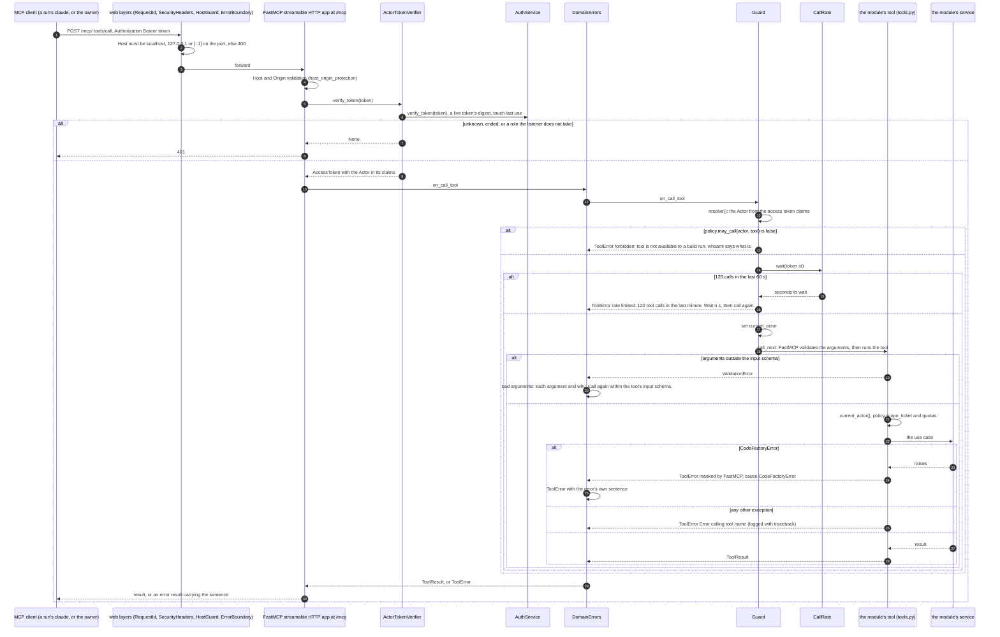

# MCP request

How one MCP tool call over HTTP at `/mcp` with a bearer token is verified, guarded, run and answered.

Source: `src/code_factory/app.py`, `src/code_factory/platform/web/app.py`, `src/code_factory/platform/mcp/http.py`, `src/code_factory/platform/mcp/server.py`, `src/code_factory/platform/mcp/verifier.py`, `src/code_factory/platform/mcp/access.py`, `src/code_factory/platform/mcp/rate.py`, `src/code_factory/platform/mcp/errors.py`, `src/code_factory/platform/mcp/policy.py`, `src/code_factory/auth/service.py`

## Notes

- `tools/list` passes the same Guard: it answers only the tools the actor's role and stage may call, in the order of `policy.TOOLS`. A run whose stage is not spec, build, review or split sees only `whoami`.
- The rate limit is a sliding window per token, in memory, per listener process.
- Scope refusals come from the tool: a run is scoped to its own ticket (`out_of_scope: this run is scoped to <id>; ...`), and the scope check runs before any lookup, so an existing and a missing ticket are refused alike.
- The mounted server has no lifespan of its own; the HTTP app's lifespan starts the shared runtime.
- Over stdio (`code-factory mcp`) there is no bearer: the process's `CODE_FACTORY_MCP_TOKEN` is verified again on every call, and an ended token answers `forbidden: this token has ended. ...`.
- `Access.roles` (a listener that takes only some roles) exists, but both places that build an `Access` (`app.py`) leave it unset, so the HTTP listener at `/mcp` accepts every role.
- `/mcp` is outside the owner's cookie guard; the bearer token is its only credential.
