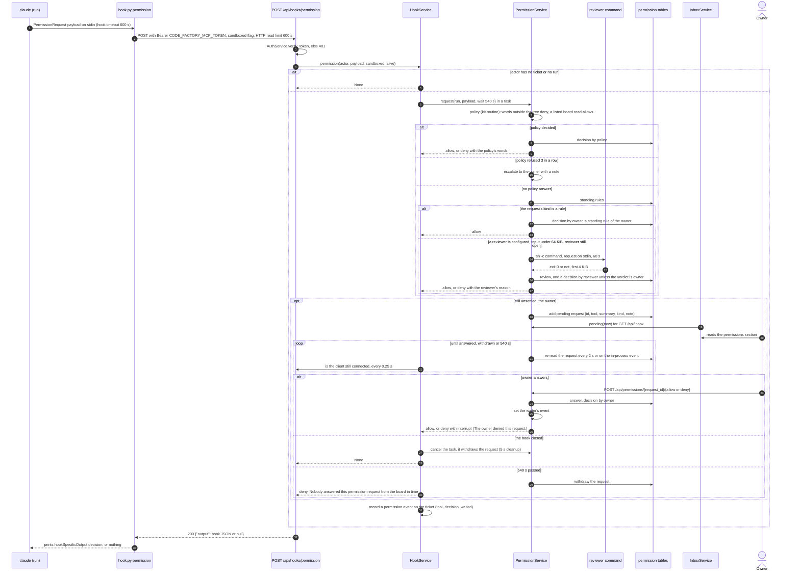

# Permission request

How a run's PermissionRequest hook is settled by the board's policy, a standing rule, the reviewer or the owner, and how the answer gets back to the agent.

Source: `src/code_factory/hooks/adapters/hook.py`, `src/code_factory/platform/web/guard.py`, `src/code_factory/hooks/routes.py`, `src/code_factory/hooks/service/base.py`, `src/code_factory/hooks/service/permission.py`, `src/code_factory/hooks/service/neighbours.py`, `src/code_factory/runs/service/permissions.py`, `src/code_factory/runs/adapters/reviewer.py`, `src/code_factory/runs/rules/hook_output.py`, `src/code_factory/agents/rules/hooks.py`, `src/code_factory/agents/rules/permissions.py`, `src/code_factory/inbox/service/neighbours.py`, `src/code_factory/runs/routes.py`

## Notes

- The waits line up: the runtime kills the hook at 600 s (`PERMISSION_TIMEOUT_S`), the hook's socket gives up at 600 s, the board answers by 540 s (`WAIT_S` in both `hooks/service/base.py` and `runs/service/permissions.py`).
- An owner's answer to a request older than 540 s is refused with 409 (`this request waited longer than 9 minutes, ...`), one already answered with 409, one whose hook closed with 404 (`the agent stopped waiting for this answer`).
- Only the owner's deny interrupts the run; a deny by the policy, the reviewer or the timeout carries words so the run tries another way.
- `/api/hooks/` routes pass the owner's cookie guard and check the bearer token themselves.
- The hook prints nothing and exits 0 on any failure: no token, a non-loopback `CODE_FACTORY_URL`, a refused connection, a non-200 answer or a body over 1 MiB.
- The sandbox allowance (a Bash call of a sandboxed run is allowed when no reviewer is configured) is not reachable from the hook: `PermissionsAdapter.request` drops the `sandboxed` flag, and `RunLauncher` removes every `CODE_FACTORY_` variable, so `CODE_FACTORY_SANDBOXED` is never set for a run.
- On start the run keeper withdraws pending requests made before it started (their waiters died with the previous process); every 30 s it expires requests older than 540 s and prunes decisions older than 90 days.
- A pushed reply link can answer the same request (see `push-and-reply.md`).
