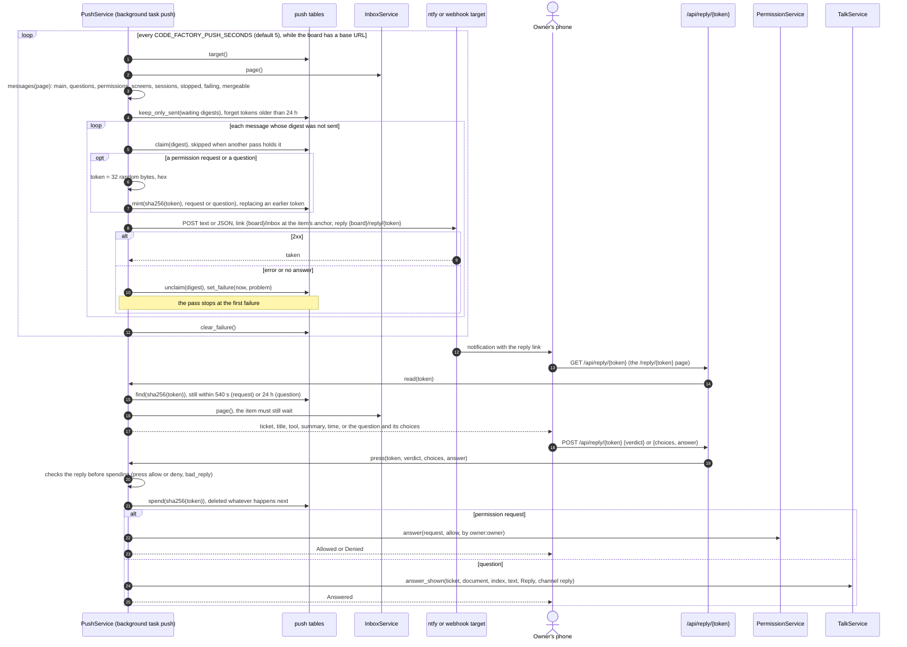

# Push and reply

How the push pass turns waiting Inbox items into delivered messages, and how a reply link answers a permission request or a question without the sign-in.

Source: `src/code_factory/push/module.py`, `src/code_factory/push/service.py`, `src/code_factory/push/rules.py`, `src/code_factory/push/repository.py`, `src/code_factory/push/adapters.py`, `src/code_factory/push/routes.py`, `src/code_factory/platform/web/guard.py`, `src/code_factory/runs/service/permissions.py`, `web/src/router.ts`

## Notes

- Every link failure answers 404 with one sentence, `this link was used, has expired or is not known`, so a holder cannot tell a used token from an expired or unknown one. A refused permission answer (`NotFoundError`, `ConflictError`) is turned into the same 404.
- A GET changes nothing (link scanners and notification previews fetch links); only the POST answers and spends the token.
- The guard lets `GET` and `POST` on `/api/reply/<64 hex>` through without the owner's cookie; the origin and JSON rules still apply to the POST.
- Only the token's SHA-256 digest is stored. A request token answers for 540 s (the hook's wait), a question token for 86 400 s.
- Only messages for permissions and questions carry a reply link; every other section's message links to the Inbox only.
- A message names its kind, ticket and Inbox anchor, nothing else an item holds. Delivery uses no proxy and follows no redirect; timeout 3 s, connect 2 s. A plain `http://` target is refused unless its host is `localhost`, `127.0.0.1` or `::1`.
- The Inbox header shows the target's host and the last failure (`PushService.summary`, reported to `InboxService` at start).
- The `sessions` section is in the pushed list, but the Inbox has no source for it yet, so it never sends.
