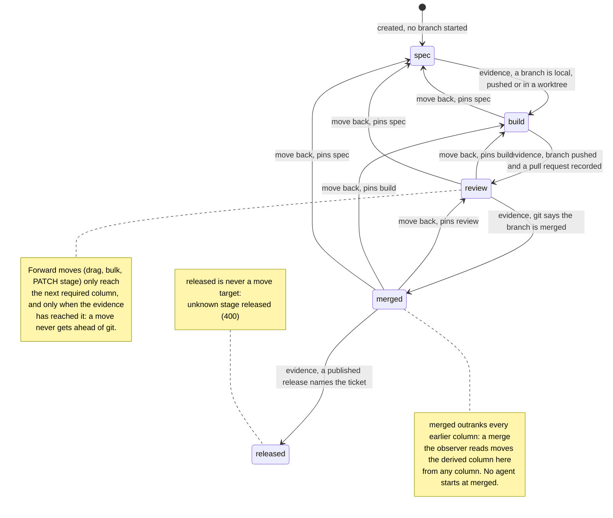

# Ticket stages

The column a ticket is in: derived from the evidence on its branch, or pinned by a declared move, and the refusals that keep a move from happening.

Source: `src/code_factory/stages/models.py`, `src/code_factory/stages/rules/evidence.py`, `src/code_factory/stages/rules/columns.py`, `src/code_factory/stages/service/assess.py`, `src/code_factory/stages/service/observe.py`, `src/code_factory/stages/service/review.py`, `src/code_factory/ticket_writes/routes.py`, `src/code_factory/ticket_writes/service/moving.py`, `src/code_factory/ticket_writes/service/editing.py`, `src/code_factory/ticket_writes/rules/bulk.py`, `src/code_factory/runs/service/starting.py`

## Notes

- Column = the declared pin when there is one, else the derived stage (`effective_stage`). A pin wins over later evidence: a ticket pinned to build stays in build after its merge until the pin is cleared (`POST .../move` with an empty `stage`) or moved.
- What moves a ticket: the `stage-observer` (every `CODE_FACTORY_STAGE_OBSERVE_SECONDS`, default 30, never under 5, and the follower's observe step) refreshing the git facts the evidence is derived from; `POST /api/tickets/{repository}/{id}/move` and `POST /api/tickets/bulk` with `stage` (`StageService.move` and `move_many`); `PATCH /api/tickets/{repository}/{id}` with `stage` (`StageService.declare`, after the same refusals); an undo of a move (`declare` with `expect`).
- Refusals, each a sentence: `<id> moves one column at a time: <Next> is next`; `<id> needs <detail> before <Column>` (with `: start an agent on it, or run code-factory start <id>` when the detail is a branch); `unknown stage <name>` (400); `git facts of <id> are unknown` (503, the last git read failed, for `move` only); `<id> stage changed since it was read` (409, an undo whose pin changed). A move refusal (`MoveRefusedError`) is a 400.
- A bulk stage move is all or nothing: every refusal is joined with `; ` and nothing is written.
- A drop on the column the evidence already reached, with nothing declared, declares nothing (the card keeps following its evidence) and offers no undo.
- Backward moves are never refused; they pin the card to the earlier column.
- A column's work-in-progress limit (`PUT` column limit) never refuses a move; only the follower's queue reads it.
- The MCP `update_ticket` tool cannot change a column: it has no stage field.
- Not built: a review run's verdict sending the ticket back to build. `StageService.apply_review` would pin build on a `changes` decision (and `begin_fix_round` starts fix rounds), but nothing calls either.
