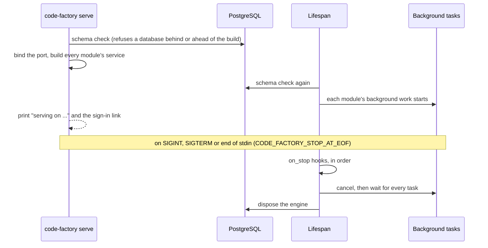

# Operations Guide

Running the board day to day: what the process does, what it keeps outside the database, how to
watch it and what to do when it refuses to start.

For setup, backups and upgrades, see the [Quick Start](../quickstart.md). How requests are served
and guarded is in [api.md](../api.md).

---

## The process

`code-factory serve` is one process on one port (`CODE_FACTORY_PORT`, 4000): the Vue app, the API
under `/api`, Swagger and the MCP server at `/mcp`. Nothing is installed into the operating system
([decision](../decisions/web-app-not-a-service.md)).



| Phase | What happens | Source |
|---|---|---|
| Start | The Local and Server mode launchers migrate their own databases. `code-factory serve` checks the schema and refuses an incompatible revision | `scripts/start.sh`, `scripts/compose-entrypoint.sh`, `platform/db/schema.py` |
| Background | Each module with background work starts its tasks in the lifespan's task group; the modules are marked in the [feature map](../reference/feature-map.md) | `platform/web/lifespan.py` |
| A task fails | It is logged as `background task <name> failed` with the traceback; its siblings and the app keep running. Restarting `serve` starts it again | `platform/background.py` |
| Stop | The `on_stop` hooks run first (for example running checks drain and the follower lets go), then the tasks are cancelled; open requests get `CODE_FACTORY_SHUTDOWN_TIMEOUT_S` (10) seconds | `platform/runtime.py`, `platform/cli.py` |
| Agents | Runs outlive the board: stopping `serve` signals no agent process | `runs/module.py` |

Stopping agents on purpose is a command, not a restart:

```sh
uv run code-factory halt              # stop every agent and hold them until resume
uv run code-factory resume
uv run code-factory runs list --active
uv run code-factory runs stop <run>
```

## Probes

| Path | Answers | Needs |
|---|---|---|
| `GET /api/health` | `{"status": "ok"}` whenever the event loop answers | nothing; no session, no database |
| `GET /api/ready` | `{"status": "ready"}`, or `503` problem+json when the database does not answer `select 1` within `CODE_FACTORY_READY_TIMEOUT_S` (2) seconds | no session |

```sh
curl -s http://127.0.0.1:4000/api/ready
uv run code-factory db check     # database is at head (revision ..., data format ...)
```

## Logs

Every record is one JSON object per line on **stderr**: `time`, `level`, `logger`, `message`,
`request_id` and any `extra` fields, with `exception` holding the traceback. Stdout stays free
because `code-factory mcp` speaks the protocol on it. Records go through a bounded queue to a
writer thread, so logging never blocks the event loop. uvicorn's access log is off.
`CODE_FACTORY_LOG_LEVEL` sets the level (`INFO`). Source: `platform/logging.py`.

```sh
uv run code-factory serve 2>>~/.local/state/code-factory/serve.log   # the link stays on the terminal
```

The password never appears in a log, an error or a `repr`: the database target in messages is
`host:port/database`.

## Files outside the database

Everything below lives under `CODE_FACTORY_STATE_DIR`. The default for plain `serve` is
`~/.local/state/code-factory`, the Local mode launcher uses `~/.local/state/code-factory-native`
by default, and Server mode uses `/data/state` in its named volume.

| Path | What | Written by |
|---|---|---|
| `runs/<run>.log` | a run's output, streamed by its process | `runs/service/base.py` |
| `runs/<run>.exit`, `runs/<run>.patterns.json` | the exit code the run wrapper writes; the patterns it redacts output with | `runs/service/base.py` |
| `previews/<ticket>.log` | a ticket preview's output | `runs/service/previews.py` |
| `checks/` | the checks command's logs, read back in the Inbox and on a ticket | `checks/adapters/logs.py` |
| `captures/` | screen captures waiting on the owner (`code-factory shoot`) | `screens/module.py` |
| `spool/` | session events the capture hook wrote, before the board ingests them | `sessions/rules/capture.py` |
| `capture-errors.log` | a capture the hook could not write, with the reason | `sessions/rules/capture.py` |
| `redaction.json` | the redaction the capture hook applies | `sessions/adapters.py` |

The capture hook runs in the agent's process, not the board's; it reads `CODE_FACTORY_STATE_DIR`
from its own environment, so a non-default state folder must be set there too.

`CODE_FACTORY_RELEASES_DIR` and `CODE_FACTORY_RUN_DIR` are validated settings that no code reads
yet.

## Process tuning

These are read from the process environment only, not from the env files
(`platform/config.py` reads the env files into the settings, never into `os.environ`).

| Variable | Default | Sets | Source |
|---|---|---|---|
| `CODE_FACTORY_STAGE_OBSERVE_SECONDS` | `30` | seconds between stage observations, never under 5 | `stages/module.py` |
| `CODE_FACTORY_FOLLOWER_SECONDS` | `5` | seconds between follower passes | `follower/module.py` |
| `CODE_FACTORY_DELIVERY_SECONDS` | `10` | seconds between delivery passes (intake polls every 15) | `delivery/module.py` |
| `CODE_FACTORY_PUSH_SECONDS` | `5` | seconds between push passes | `push/module.py` |
| `CODE_FACTORY_CHECKS_CONCURRENCY` | `4` | checks runs that may go at once; anything but a whole number from 1 is refused at start | `checks/module.py` |
| `CODE_FACTORY_HEAVY_WAIT` | `1800` | seconds a checks run waits for the gate's heavy-step lock (`gate-heavy.lock`) | `checks/service/command.py` |

The database pool (`CODE_FACTORY_DB_POOL_*`) and the timeouts are ordinary settings, listed in the
[README](../../README.md#configuration).

## The key broker

A run never holds a provider key. The broker serves a listener on `127.0.0.1` at a port the system
picks; a run sends its model requests there with its run token, and the broker sends them on with
the real key and relays the answer (`broker/service/forwarding.py`). A capped run gets a provider
key made with its cap as the limit, held in this process's memory only
(`broker/service/runkeys.py`, `broker/service/vault.py`). A sweep every
`CODE_FACTORY_BROKER_SWEEP_INTERVAL_S` (30) seconds deletes the keys of runs that ended.

```sh
uv run code-factory broker status    # live tokens and keys waiting to be deleted
uv run code-factory broker sweep     # one sweep pass now
```

## Security measures

| Measure | Where |
|---|---|
| The database password is read from the keychain when the URL leaves it out; it is a `SecretStr` everywhere | `platform/keychain.py`, [decision](../decisions/keychain-password.md) |
| Every `/api` path but the probes, reply links and hooks needs the owner's session; a change from another origin is `403` | `platform/web/guard.py`, [api.md](../api.md) |
| `/mcp` takes bearer tokens only: the owner's, or a run's bound to its ticket and stage and revoked at its end; 120 tool calls a minute each | `platform/mcp/`, `auth/` |
| A Content-Security-Policy with `script-src 'self'`: no inline script, no eval | `platform/web/`, [api.md](../api.md) |
| Provider keys stay in the operating system's credential store and the broker; a run sees a run token | `agents/`, `broker/` |

```sh
uv run code-factory sign-out          # end every owner browser session
uv run code-factory token list        # the owner's MCP tokens
uv run code-factory token revoke <id>
```

## Troubleshooting

Every error is one sentence that names the repair. The ones met at start:

| Message | Cause | Repair |
|---|---|---|
| `the database at 127.0.0.1:5432/code_factory is not reachable (ConnectionRefusedError: ...)` | A manually configured PostgreSQL instance is not running | Start the database configured in your environment |
| `http://127.0.0.1:4000 is already in use` | Another process already has the port | Open the running board if it is Factory, or use the port setting for your [setup mode](../quickstart.md) |
| `CODE_FACTORY_DATABASE_URL names no password and the keychain holds none for <user>: add it with security add-generic-password ...` | the URL leaves the password out and the keychain item is missing | the command in the message ([Quick Start](../quickstart.md#set-up-once)) |
| `the database has no schema yet; run code-factory db upgrade` | a new database | `uv run code-factory db upgrade` |
| `the database is at revision X but this build expects Y; ...` | the code moved on, or an older build runs against a newer database | back up, then `uv run code-factory db upgrade` ([Upgrade](../quickstart.md#upgrade)); or run the build that wrote the database |
| `the database did not answer the schema check within 5 s: it is busy, ...` | a migration or a long transaction holds the schema | retry; `CODE_FACTORY_SCHEMA_CHECK_TIMEOUT_S` sets the wait |
| `/` answers `503`: `the web app is not built; ...` | `src/code_factory/platform/web/dist` is missing | `pnpm --dir web install && pnpm --dir web build`; the API works meanwhile |
| A tab says `The board was updated; reload the page to see it.` | the board was rebuilt and restarted under it (`X-Code-Factory-Build` differs) | reload; the tab never reloads by itself |
| `403` on every `/api` call | no owner session in this browser | `uv run code-factory open`, or `sign-in` for a link |
