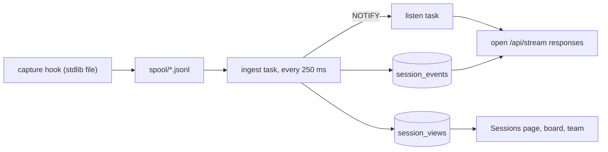

# Agent sessions

What every coding agent session does is recorded by a hook, kept in an event ledger in Postgres and
read back as live views, timelines, usage and a stream. The code is `src/code_factory/sessions/`;
`service/session.py` (`SessionService`) is its public API and the tables are in `tables.py`.

## The hook

`rules/capture.py` is run by path (`python -I -S`), never through the package: importing
`code_factory` costs more than the hook budget and the interpreter start is its floor. It imports
only the standard library (`tests/sessions/test_capture_script.py` walks its imports), so the
secret patterns exist twice, here and in `platform/text/masking.py`, and a test holds them equal.

- It never prints and exits 0 whatever happens. A payload it cannot record is one line in
  `capture-errors.log` with the reason and the first 200 bytes.
- One `O_APPEND` write per line, mode 0600, so concurrent hooks never interleave.
- Secrets are masked by text pattern (`password=...`) and by key: a string under a key that names a
  secret (`password`, `api_key`, `authorization`, `github_token`...) is `[redacted]`.
- A string over 2,000 characters becomes `{"_trimmed_chars": n, "head": <first 200>}`; a tool
  output that held `gate: <step> failed (exit <n>)` lines keeps them in a `gates` list, which is
  what `recurring_failures` reads. The error log holds only masked, redacted text.
- The owner's agent context must not reach the spool. The board publishes `redaction.json`
  (`SessionService.publish_redaction`); a run names its context in `CODE_FACTORY_CONTEXT` and the
  hook keeps nothing of a payload when the file does not list it.
- `SessionService.capture_hook()` is the command to install, as an asynchronous command hook: the
  agent does not wait for it and a board that is down loses nothing. It names the state folder
  (`env CODE_FACTORY_STATE_DIR=... python -I -S capture.py`), so an agent that does not inherit
  the board's environment writes where the board reads. `scripts/bench_capture.py` times it; see
  Measured below.

## The ledger

| Table | Holds |
|---|---|
| `session_events` | one row per spool line that is an event; `seq` is the stream's position |
| `session_rejects` | a line that is no event: bad JSON, not an object, over 8 MiB; skipped once |
| `session_spool_progress` | the byte offset the ingest reached in each spool |
| `session_views` | each session's unsettled view, written in the ingest transaction |
| `session_run_requests` | the model requests a run reported through its telemetry |

Constraints the code cannot say:

- Rows are derived from the spool and can be rebuilt from it. A spool is never deleted by the
  ingest: a recreated name would restart at offset 0 (`prune_spools` removes a spool together with
  its rows, and its progress only once the file is gone).
- One ingester at a time, by an advisory lock held through the commit. The stream reads by
  `seq > last`, so two interleaved commits could make a lower `seq` visible after a higher one.
  Progress moves by compare-and-set; a batch whose spool another ingester moved, shrank or pruned
  since it was read rolls back. A prune or rebuild that cannot take the lock in 5 s refuses.
- `payload` is `json`, not `jsonb`: its key order is part of what the stream sends. A line holding
  `NaN`, an infinity, or a NUL or lone surrogate in a text field is rejected rather than failing
  the insert; in the fields a view copies out of a payload they are replaced.
- A session view is derived from the events since its latest `SessionStart` (the window). Only the
  working folder and the transcript reach back before it. Ended and stale come from the clock and
  are applied at read (`rules/settle.py`), so a stored view never goes stale.
  `rules.derive.RULES_VERSION` rises when a rule changes what a view holds; the ingest task
  rebuilds older rows at start (`code-factory sessions rebuild` does it on demand).
- The window of a session is cached in process (256 sessions); a cache that is behind the table is
  read again. A window is derived on every batch, however long: deriving 5,000 events takes about
  2 ms at the median (target 30 ms, pinned in `tests/sessions/test_sessions_perf.py`), so the
  once-per-second debounce the spec allowed for is not needed and not built.
- A process whose spool folder is empty or missing never touches the database: the ingest task
  looks at the folder first, and checks for views older than the rules only once a spool exists.

## Reading

`SessionService` methods map to the HTTP routes and MCP tools that other modules own. Reads never
touch the spool. A Sessions page without `ended` reads only the rows not ended by the clock; the
ended ones are counted. The transcript usage of a session is read incrementally from where the last
read stopped, with the totals of at most 500 transcripts kept.

## The stream

`event_stream` sends `id: <seq>` frames in batches of 1,000 and wakes on `NOTIFY session_events`,
which the listen task receives on one connection of its own. After a reconnection every open
stream reads again, a read every 5 s covers a lost notification, and a keepalive frame goes out
after 15 s of quiet. Shutdown ends every open stream.

## Measured

The hook, `scripts/bench_capture.py`, 1,000 runs of the stdlib file, CPython 3.14, on a laptop
that was also running other builds (2026-11-23):

| Scenario | p50 | p99 | min |
| --- | --- | --- | --- |
| idle | 88.0 ms | 240.5 ms | 29.1 ms |
| 8 at once | 133.7 ms | 334.8 ms | 27.8 ms |

The minimum is the interpreter start (`python -I -S -c pass`, about 20 to 30 ms on a quiet
machine); the medians are that plus the load of the machine. The hook is installed asynchronously
(the agent does not wait for it), so the latency is not paid per tool call; rerun the script on a
quiet machine before reading the medians as the hook's own cost.
